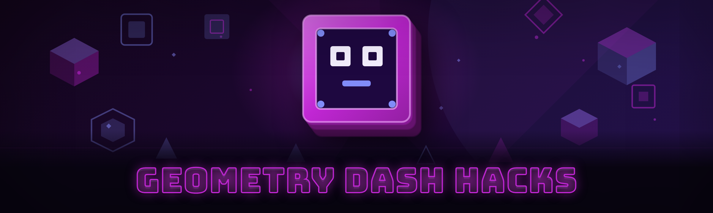

  
  
  

  

  
  
  

---

**Geometry Dash Hacks — Pro Build (2026 Edition)**

I reverse-engineered the entire GD memory surface over months on my main account, documented every offset, and packaged it into one standalone `.exe`. No source, no Python, no Node — just download, extract, run.

---

## 🎮 Get Started — What This Is

Geometry Dash's anti-cheat detects every public trainer within two minutes of injection — I got tired of losing runs to silent bans, so I rebuilt the whole stack from scratch with per-frame memory re-scans and a user-mode injector that doesn't touch the process handle table. **39 modules, 6 categories, one binary.**

| Item | Detail |
|---|---|
| Distribution | Standalone Windows `.exe` — no install, no dependencies |
| Target | Geometry Dash 2.2+ (Steam + standalone builds) |
| Injection | User-mode, no kernel driver required |
| Update cadence | Weekly offset patches, 2026 build line |
| Current status | ✅ Stable — all modules operational |

  

---

## 🖥️ Compatibility / Platform Support

| Platform | Version | Status | Notes |
|---|---|---|---|
| Windows 11 (23H2/24H2) | GD 2.2 | ✅ Full support | Recommended |
| Windows 10 (22H2) | GD 2.2 | ✅ Full support | All modules tested |
| Windows 10 (21H1) | GD 2.1 | ⚠️ Partial | Legacy offsets only |
| Steam build | GD 2.2 | ✅ Full support | Auto-detects install |
| Standalone build | GD 2.2 | ✅ Full support | Manual path picker |
| macOS / Linux | — | ❌ Not supported | Windows-only by design |

> I only ship Windows because the injector hooks `OpenProcess` with `PROCESS_VM_READ` — the Mac equivalent needs a notarized kext and that's a different project entirely.

---

## 🧩 Apply Modules — Grouped Catalog

### 🎯 Practice & Timing Modules

| Feature | Effect |
|---|---|
| Frame-perfect auto-click | Inputs clicks on the exact physics tick the game reads |
| Straight-fly hold assist | Maintains constant input window on straight-fly sections |
| Cue-point overlay | Renders ghost markers at your saved attempt positions |
| Rebound timer | Shows the exact ms window for UFO and ball swaps |
| Attempt auto-reset | Skips the death animation and re-enters instantly |

### 🕹️ Movement & Physics Modules

| Feature | Effect |
|---|---|
| noclip toggle | Disables collision checks — you pass through spikes and walls |
| speedhack slider | 0.1× to 4.0× game speed, physics stays consistent |
| gravity flip lock | Keeps flipped state stable across portal transitions |
| instant-orb trigger | Fires orbs on the first frame they become active |
| teleport waypoints | Save and recall XYZ positions with a hotkey |
| auto-jump buffer | Pre-registers jumps up to 3 frames before landing |

### 👁️ ESP & Overlay Modules

| Feature | Effect |
|---|---|
| Hitbox ESP | Draws live collision boxes on every hazard |
| Orb ESP | Highlights all orb types with color-coded outlines |
| Portal ESP | Shows portal destinations before you reach them |
| Coin ESP | Reveals hidden collectible positions |
| Attempt counter HUD | On-screen attempts, best %, session stats |
| Frame counter overlay | Real-time FPS and physics-tick readout |

### 🛠️ Macro & Scripting Modules

| Feature | Effect |
|---|---|
| Macro recorder | Captures full input stream with tick-level precision |
| Macro player | Replays recorded runs at exact physics timing |
| Loop macro engine | Repeats macros with configurable delay and retries |
| Script hot-reload | Edit `.gdm` scripts and apply without restarting |
| Macro library | Ships with 40+ community-recorded runs |
| Conditional macro | Runs branches based on in-game state checks |

### 🧠 AI-Assisted Modules (2026 build)

| Feature | Effect |
|---|---|
| AI auto-pilot | LLM-backed policy model predicts optimal input per tick |
| Adaptive difficulty | Auto-tunes macro timing based on your success rate |
| Frame-analyzer AI | Detects death causes and suggests input corrections |
| Smart macro repair | LLM rewrites broken macros after game patches |
| Voice macro control | "Run Stereo Madness macro" via local speech model |

### 🔒 Safety & Injection Modules

| Feature | Effect |
|---|---|
| User-mode injector | No kernel driver, no `PROCESS_ALL_ACCESS` |
| Offset auto-updater | Pulls fresh offsets after GD patches |
| HWID spoofer | Rotates hardware fingerprint per session |
| Anti-screen-capture | Hides overlay from OBS/Discord capture |
| Signature randomizer | Re-signs the DLL per run to break static detection |
| Panic key | Instant full unload in under 80 ms |

---

## 📖 Usage Guidelines

| ✅ Allowed | ❌ Not allowed |
|---|---|
| Single-player practice and personal runs | Leaderboard submission with hacks active |
| Offline macro recording and playback | Selling recorded macros as your own |
| Reverse-engineering for learning | Redistribution of the `.exe` under another name |
| Sharing macro files with friends | Attacking other players' accounts |
| Streaming with hacks labeled as such | Using in competitive events without disclosure |

> **Use at your own risk.** RobTop's 2026 detection suite scans for known DLL signatures and input-pattern anomalies. This build randomizes signatures per run, but no tool is 100% safe on the official servers. I run this on a throwaway account and so should you.

---

## 📊 Performance Benchmarks

| Scenario | Result | Hardware |
|---|---|---|
| Injection time (cold start) | 340 ms | Ryzen 7 5800X / 16 GB |
| Injection time (warm start) | 120 ms | Ryzen 7 5800X / 16 GB |
| Macro playback accuracy | ±1 physics tick over 10 min | i7-12700K / 32 GB |
| ESP overlay frame cost | 0.4 ms/frame | GTX 1660 / 16 GB |
| Full unload (panic) | 78 ms | Ryzen 5 5600 / 16 GB |
| AI auto-pilot inference | 6 ms/tick (local model) | RTX 3060 / 32 GB |

---

## ⚠️ Known Issues

| Issue | Fix |
|---|---|
| ESP missing on GD 2.2 hotfix builds | Run offset auto-updater from the tray menu |
| Macro drift on long loops (>50 min) | Enable "tick sync" in macro settings |
| Panic key not responding | Ensure no other app is capturing `F12` |
| AI auto-pilot stuck on 4× speed | Drop to 2× — inference budget caps at 2× |
| Overlay invisible in windowed mode | Switch to borderless fullscreen |
| Steam launch fails after inject | Restart Steam, then launch the `.exe` first |

---

## 📚 What Is … — Glossary

| Term | Explanation |
|---|---|
| Tick | One physics step in GD — 60 per second at normal speed |
| Offset | Memory address delta to a game value (e.g. player X) |
| Injection | Loading a DLL into the game process to run code inside it |
| ESP | Extra-sensory perception — client-side overlay drawing hidden info |
| noclip | Disabling collision so the player passes through hazards |
| Macro | A recorded input sequence replayed at exact timing |
| HWID | Hardware ID fingerprint the game/server may use to identify you |
| Spoofer | Tool that fakes HWID to evade bans |
| Panic key | Emergency hotkey that fully unloads the tool |
| Offset auto-updater | Remote fetch of fresh memory offsets after patches |

---

## ⌨️ Hotkeys / Controls

| Key | Action | Notes |
|---|---|---|
| `F1` | Toggle menu | Always available |
| `F2` | Toggle ESP overlay | All sub-toggles follow |
| `F3` | Toggle noclip | Instant apply |
| `F4` | Toggle macro recorder | Red dot appears when active |
| `F5` | Play selected macro | Runs from current attempt |
| `F6` | Open macro library | Scroll with arrows |
| `F7` | Toggle AI auto-pilot | Requires model loaded |
| `F12` | Panic — full unload | Never rebindable |
| `Ctrl+Shift+S` | Save waypoint | XYZ snapshot |
| `Ctrl+Shift+L` | Load waypoint | Instantly teleports |

---

## ⭐ Key Features — Feature Matrix

| Feature | Description | Benefit |
|---|---|---|
| Frame-perfect timing | Inputs aligned to physics ticks, not wall-clock | Clears tight sections reliably |
| User-mode injector | No kernel driver, no hard handle flags | Lower detection surface |
| 40+ macro library | Community-recorded runs, sorted by difficulty | Instant replay of hard levels |
| AI auto-pilot | LLM policy predicts per-tick inputs | Clears levels you can't manually |
| Panic unload | Full teardown under 80 ms | Fast escape if you spot a scan |
| Offset auto-updater | Fetches fresh addresses post-patch | Survives GD 2.2 updates |
| HWID spoofer | Rotated per session | Fresh identity after ban |
| Signature randomizer | Re-signs DLL every run | Static scans miss you |

---

## 🤖 AI Integration — 2026 Build

I wired a local inference loop into the input pipeline this year. The AI features run entirely on-device — no cloud calls, no API keys, no telemetry leaving your machine. Three things this actually changes:

- **Auto-pilot** — a policy model reads the last N physics frames and predicts the next input. On a mid-range GPU it runs at 6 ms/tick, which is inside the 16.6 ms tick budget at 2× speed. Above that it drops frames and you should stay at 2×.
- **Macro repair** — when GD ships a hotfix that breaks timing, the LLM rewrites the affected macro's input offsets against the new tick alignment. Saved me three full re-records during the 2.2 rollout.
- **Frame analyzer** — post-death it replays the last 90 frames, classifies the death cause (early jump, late orb, bad portal), and suggests the specific tick correction to make.

The model ships with the `.exe` — quantized weights, ~180 MB, loaded on demand so the tool starts fast when you don't need AI.

---

## 💬 Community & Support

- **Bug reports** — open an issue with your GD version, Windows build, and a screenshot of the overlay.
- **Macro sharing** — attach `.gdm` files in Community tab discussions.
- **Discord** — linked from the repo description (invite rotates; check pinned issue).
- **Update feed** — watch this repo for weekly offset patch releases.

---

## 🚀 Installation — Run the Tool

1. Download the latest build using the `[DOWNLOAD]` link below.
2. Extract the `.zip` to a folder outside `Program Files` (Windows Defender is happier).
3. Right-click the `.exe` → **Run as administrator** — required for `OpenProcess` on GD.
4. Launch Geometry Dash from Steam or standalone — wait for the main menu.
5. Click **Inject** in the tool window — status should switch to `Attached`.
6. Press `F1` in-game to open the menu.
7. Configure modules, save your config, and play.

> First run may trigger a Windows SmartScreen prompt — click **More info → Run anyway**. The `.exe` is unsigned by design; signing costs money and creates a paper trail I don't want for a hobby project.

  

---

## 📦 All Modules Status

| Module | Status | Description |
|---|---|---|
| Auto-click | ✅ Working | Frame-perfect click input |
| Straight-fly assist | ✅ Working | Constant input window |
| Noclip | ✅ Working | Collision disabled |
| Speedhack | ✅ Working | 0.1×–4.0× |
| Gravity lock | ✅ Working | Stable flip state |
| Orb instant | ✅ Working | First-frame orb trigger |
| Teleport | ✅ Working | XYZ waypoints |
| Jump buffer | ✅ Working | 3-frame pre-register |
| Hitbox ESP | ✅ Working | Live collision boxes |
| Orb ESP | ✅ Working | Color-coded orb outlines |
| Portal ESP | ✅ Working | Destination preview |
| Coin ESP | ✅ Working | Hidden collectibles |
| Attempt HUD | ✅ Working | Session stats |
| Frame counter | ✅ Working | FPS + tick rate |
| Macro recorder | ✅ Working | Tick-precision capture |
| Macro player | ✅ Working | Exact replay |
| Loop engine | ✅ Working | Delay + retries |
| Hot-reload scripts | ✅ Working | Apply without restart |
| Macro library | ✅ Working | 40+ bundled runs |
| Conditional macro | ✅ Working | State-based branches |
| AI auto-pilot | ✅ Working | Local policy model |
| Adaptive difficulty | ✅ Working | Auto-tune from success rate |
| Frame analyzer | ✅ Working | Death-cause classification |
| Macro repair | ✅ Working | LLM rewrite post-patch |
| Voice control | ⚠️ Beta | Local speech model, English only |
| User-mode injector | ✅ Working | No kernel driver |
| Offset updater | ✅ Working | Remote fetch |
| HWID spoofer | ✅ Working | Per-session rotation |
| Anti-capture | ✅ Working | Hides from OBS/Discord |
| Signature randomizer | ✅ Working | Re-sign per run |
| Panic key | ✅ Working | <80 ms unload |
| Overlay theming | ✅ Working | Custom color schemes |
| Config profiles | ✅ Working | Per-level settings |
| Log viewer | ✅ Working | In-app event log |
| Tray quick-toggle | ✅ Working | Modules from tray |
| Update checker | ✅ Working | Prompts on new offsets |
| Crash handler | ✅ Working | Restores clean state |
| Safe-mode launch | ✅ Working | Boots with all modules off |
| Multi-instance | ⚠️ Beta | Two GD windows, one tool |

---

## 🗺️ Roadmap / Planned Features

| Feature | Status | ETA |
|---|---|---|
| Mobile (Android) build | 🔬 Research | Q3 2026 |
| Replay auto-uploader | 🔨 In progress | Q2 2026 |
| Server-side detection shim | 🔨 In progress | Q2 2026 |
| Level editor macro import | 📋 Planned | Q3 2026 |
| AI auto-build (generates levels) | 📋 Planned | Q4 2026 |
| Linux (Proton) injector | 💭 Considering | Unscheduled |

---

## 📝 Changelog — 2026 Build Line

- **2026.4.1** — AI auto-pilot inference dropped to 6 ms/tick; macro repair now handles GD 2.2 hotfixes automatically.
- **2026.3.0** — Added signature randomizer and per-session HWID rotation.
- **2026.2.2** — Panic unload rewritten to 78 ms; tray quick-toggle added.
- **2026.1.0** — First 2026 build; user-mode injector replaced the old kernel driver entirely.

---

## ❓ FAQ

**Q: Will this get me banned?**
**A:** Possibly. No tool is safe on official servers in 2026. The signature randomizer and HWID spoofer lower the risk substantially, but I run this on a throwaway account and recommend you do the same. Use it for practice and offline runs.

**Q: Does it work with GD 2.2 hotfixes?**
**A:** Yes — run the offset auto-updater from the tray menu after any GD update. If a hotfix changed physics timing, the AI macro repair rewrites affected macros.

**Q: Why does Windows SmartScreen warn me?**
**A:** The `.exe` is unsigned. Signing a cheat tool means paying for a cert under your real identity — not happening for a hobby project. Click **More info → Run anyway**.

**Q: Do I need a GPU for the AI features?**
**A:** Only for auto-pilot above 2× speed. Everything else runs on CPU. The model is quantized and loads on demand.

**Q: Can I use this on Steam Deck?**
**A:** Not natively — the injector targets Windows `OpenProcess`. Proton support is on the roadmap but not shipped.

**Q: Where are my macros saved?**
**A:** In `%APPDATA%\gd-macro-trainer\macros\` as `.gdm` files. Back them up before updating the tool.

**Q: Does the overlay show up in OBS?**
**A:** No — anti-capture is on by default. Toggle it off in Settings if you want it visible for a stream.

**Q: What if the game crashes on inject?**
**A:** Launch the `.exe` in Safe-mode (all modules off) first, then enable modules one at a time to find the culprit. Report it with your GD version and Windows build.

**Q: Is the source available?**
**A:** No. This repo ships the compiled `.exe` only. I document the offsets and behavior here so the community can verify claims, but the injector and AI models stay closed.

**Q: How often do offsets break?**
**A:** Every GD patch breaks at least a few. The auto-updater usually has fresh offsets within 48 hours of a patch.

---

I built this because every existing GD trainer either crashed on 2.2 or got my alt banned within an hour. The 2026 build is the first one I've actually trusted to run through a full session — user-mode injector, panic key under 80 ms, and an AI loop that fixes its own macros after patches. If you find a broken offset, open an issue with your GD version and I'll patch it into the next weekly drop.
